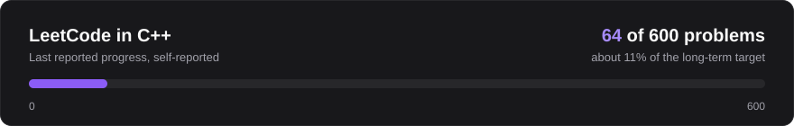

I'm Harshit Tiwari, a Full Stack Developer passionate about backend engineering, 
scalable systems, and solving challenging problems through code.

<a href="https://github.com/harshit-tiwari-codebase">GitHub</a>
&nbsp;&nbsp;|&nbsp;&nbsp;
<a href="https://www.linkedin.com/in/harshit-tiwari-48830b3b4">LinkedIn</a>
<!-- TODO after confirming the LeetCode username, add:
&nbsp;&nbsp;|&nbsp;&nbsp;
<a href="https://leetcode.com/u/YOUR_LEETCODE_USERNAME/">LeetCode</a>
-->

## About

I build full-stack products with a React frontend and a Node.js and Express backend. What pulls me in is the part behind the API: how data is modeled in MongoDB, what gets cached in Redis, how authentication is enforced, and how slow work is moved off the request path.

VerifAI is where that shows most. Submissions go through a Bull queue, execute in Judge0, and are evaluated with the Gemini API. Pixlify is where I worked through the fundamentals of a social product: auth, feeds, follows, uploads, and caching.

I'm a B.Tech CSIT student working toward software engineering roles at product-based companies.

## Current Focus

- Mastering backend engineering
- Strengthening DSA and problem-solving in C++
- Exploring system design
- Building production-grade full-stack applications
- Understanding scalable distributed systems

## Technical Skills

## Featured Projects

### More projects

## DSA & Problem-Solving Journey

I treat DSA as the base layer for interviews and for backend work: queues, cache eviction, and database indexes all come back to the same data structures. I solve problems in C++ on LeetCode.

<!-- TODO after confirming the LeetCode username, uncomment for live easy, medium and hard stats.
     Replace YOUR_LEETCODE_USERNAME in both places.

-->

## GitHub Statistics

## Contribution Graph

## Education

**B.Tech in Computer Science and Information Technology** 
IPS IES Academy, 2024 to present 
Latest reported CGPA: 9.5 (4th semester)

## Engineering Interests

I'm drawn to two questions: how a system should be structured, and how it holds up under load.

**Structure:** backend architecture, distributed systems, database design, API development. 
**Resilience:** performance optimization, caching, authentication and security, system design.

## Connect With Me

- GitHub: [harshit-tiwari-codebase](https://github.com/harshit-tiwari-codebase)
- LinkedIn: [harshit-tiwari-48830b3b4](https://www.linkedin.com/in/harshit-tiwari-48830b3b4)

Harshit Tiwari, Madhya Pradesh, India

