

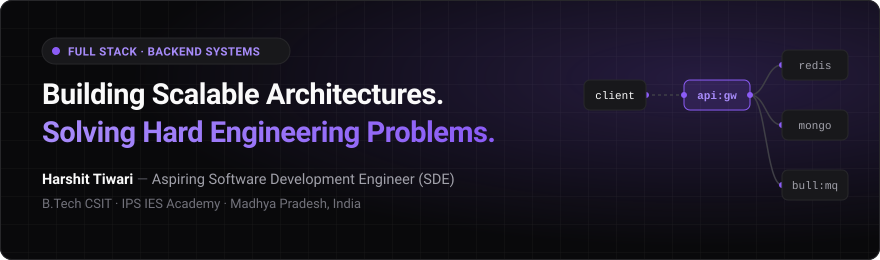

  <a href="https://github.com/harshit-tiwari-codebase"><b>GitHub</b></a>
  &nbsp;&nbsp;·&nbsp;&nbsp;
  <a href="https://www.linkedin.com/in/harshit-tiwari-48830b3b4"><b>LinkedIn</b></a>
  &nbsp;&nbsp;·&nbsp;&nbsp;
  <a href="[ADD: Portfolio URL]"><b>Portfolio</b></a>
  &nbsp;&nbsp;·&nbsp;&nbsp;
  <a href="mailto:[ADD: Email Address]"><b>Email</b></a>

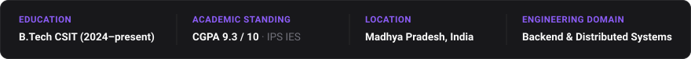

---

## 1. Hero & Overview

I am a Full Stack Developer with an engineering focus on backend systems, asynchronous pipelines, and scalable application architecture. I build software that prioritizes structural integrity, query efficiency, and clean service separation.

Currently pursuing a **B.Tech in Computer Science & Information Technology (CSIT)** at IPS IES Academy (CGPA: 9.3 / 10), I am working toward a career as a **Software Development Engineer (SDE)** at product-based companies.

---

## 2. About

My engineering work centers on what happens behind the user interface: database schema modeling, memory-tier caching, stateless authentication, and offloading heavy compute from synchronous HTTP request lifecycles.

- **VerifAI** represents my focus on distributed workflows: user-submitted source code is ingested via REST endpoints, queued through BullMQ with Redis, executed within an isolated Judge0 execution sandbox, and reviewed via the Google Gemini API for structural quality and algorithmic efficiency.
- **Pixlify** tackles full-stack social engineering: multi-entity relational patterns modeled in MongoDB, dynamic activity feed generation, media pipeline processing with ImageKit, and Redis query caching.
- **TraceMail** (currently in active development) tackles security forensics: parsing hop-by-hop SMTP relay headers and validating cryptographic email signatures (SPF, DKIM, DMARC) to detect spoofing threats.

I treat Data Structures and Algorithms as foundational tools for systems programming—informing decisions around hash ring redistribution, token bucket rate limiting, and cache eviction policies.

---

## 3. Current Focus

- **Backend Architecture & Distributed Systems**: Designing rate limiters (Token Bucket), distributed unique ID generators (Snowflake), and consistent hash rings for partitioning.
- **Algorithmic Problem-Solving in C++**: Strengthening core problem-solving techniques and computational efficiency in C++.
- **Security & Forensics Engineering**: Implementing cryptographic verification algorithms and relay chain network parsing in **TraceMail**.

---

## 4. Technical Skills

  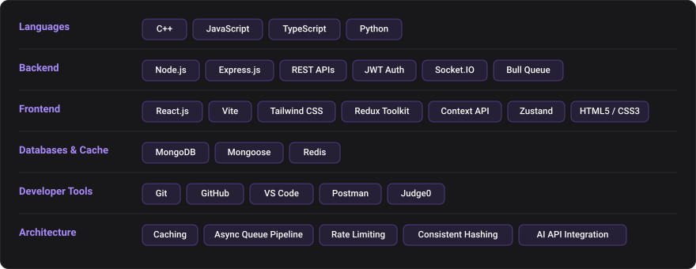

| Category | Technologies &amp; Methodologies |
| :--- | :--- |
| **Languages** | C++, JavaScript (ES6+), TypeScript, Python, HTML5, CSS3 |
| **Backend Engineering** | Node.js, Express.js, REST APIs, JWT Authentication, Socket.IO, Bull Queue, Background Job Processing |
| **Databases &amp; Caching** | MongoDB, Mongoose, Redis (In-Memory Caching &amp; Queuing) |
| **Frontend Engineering** | React.js, Vite, Tailwind CSS, Redux Toolkit, Context API, Zustand |
| **Developer Tools** | Git, GitHub, VS Code, Postman, Judge0 API, ImageKit |
| **Architecture &amp; Design** | Schema Modeling, Caching Strategies, Queue-Based Architecture, Consistent Hashing, Rate Limiting |

---

## 5. Featured Projects

  <a href="https://github.com/harshit-tiwari-codebase/VerifAi">
    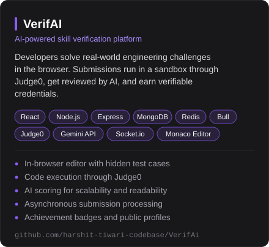
  </a>
  <a href="https://github.com/harshit-tiwari-codebase/pixlify-mern">
    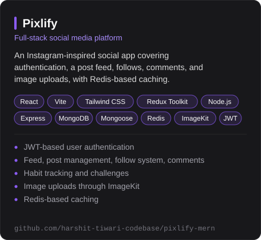
  </a>

  <a href="https://github.com/harshit-tiwari-codebase/TraceMail-">
    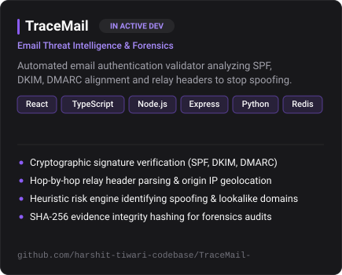
  </a>
  <a href="https://github.com/harshit-tiwari-codebase/emotify">
    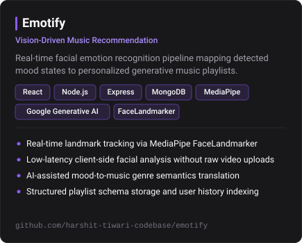
  </a>

### Additional Applications

  
  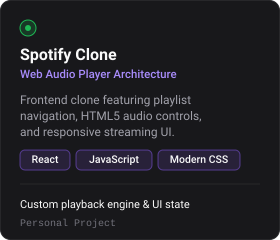
  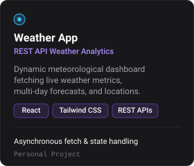

### Technical Deep Dives

| Project | Problem Solved | Core Stack &amp; Architecture | Technical Highlights | Repository |
| :--- | :--- | :--- | :--- | :--- |
| **[VerifAI](https://github.com/harshit-tiwari-codebase/VerifAi)** | Automated evaluation of developer code quality under test conditions | React, Node.js, Express, MongoDB, Redis, Bull, Judge0, Gemini API, Socket.IO | Asynchronous job execution pipeline, sandboxed remote test validation, AI readability &amp; complexity scoring | [GitHub](https://github.com/harshit-tiwari-codebase/VerifAi) · [Live App](https://verif-ai-six.vercel.app) |
| **[Pixlify](https://github.com/harshit-tiwari-codebase/pixlify-mern)** | High-interaction social application with personalized feed indexing | React.js, Vite, Tailwind CSS, Node.js, Express, MongoDB, Redis, ImageKit, JWT | Redis caching layer for feeds and profiles, normalized Mongoose schemas, media transformation pipeline | [GitHub](https://github.com/harshit-tiwari-codebase/pixlify-mern) |
| **[TraceMail](https://github.com/harshit-tiwari-codebase/TraceMail-)** *(In Active Dev)* | Email spoofing detection and forensic mail header analysis | React, TypeScript, Node.js, Express, Python, Redis | Hop-by-hop relay header parsing, cryptographic signature verification (SPF, DKIM, DMARC), SHA-256 evidence integrity | [GitHub](https://github.com/harshit-tiwari-codebase/TraceMail-) · [Live App](https://trace-mail-seven.vercel.app) |
| **[Emotify](https://github.com/harshit-tiwari-codebase/emotify)** | Real-time emotion detection mapping facial expressions to audio playlists | React, Node.js, Express, MongoDB, MediaPipe, Google Generative AI | Client-side facial landmark tracking without raw video transmission, generative AI semantic genre mapping | [GitHub](https://github.com/harshit-tiwari-codebase/emotify) |
| **[macOS Portfolio](https://github.com/harshit-tiwari-codebase/macos-dev-portfolio)** | Desktop-grade portfolio environment simulating an operating system interface | React, Tailwind CSS, Framer Motion | Dynamic window management, draggable UI controls, embedded terminal emulator, markdown note viewer | [GitHub](https://github.com/harshit-tiwari-codebase/macos-dev-portfolio) |
| **Spotify Clone** | Web music streaming application with custom audio player interface | React, JavaScript, CSS3 | HTML5 Audio API state synchronizer, dynamic playlist queuing, responsive media player controls | Personal Project |
| **Weather App** | Meteorological forecasting interface consuming multi-point weather data | React, Tailwind CSS, REST APIs | Asynchronous API fetching, coordinate query caching, responsive temperature visualization | Personal Project |

---

## 6. GitHub Stats

  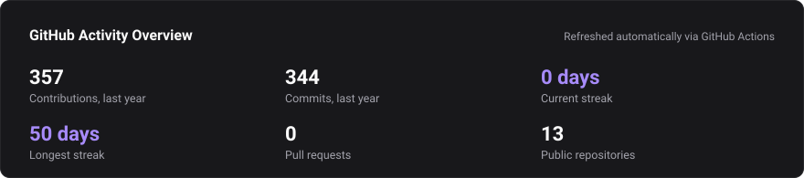
  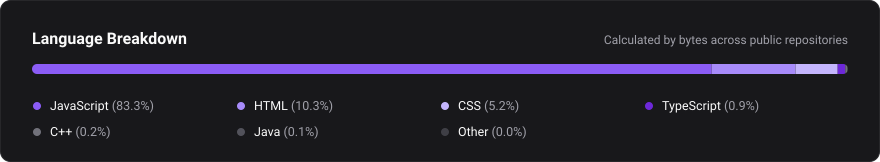

> *Stats are rendered via a self-hosted generator and kept synchronized daily with the GitHub GraphQL API using GitHub Actions (`.github/workflows/update-stats.yml`).*

---

## 7. Contribution Graph

  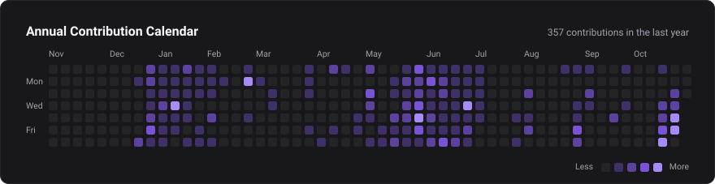

---

## 8. Education

- **Bachelor of Technology (B.Tech)** in Computer Science &amp; Information Technology (CSIT)  
  **IPS IES Academy** · *2024 – Present*  
  **Academic Standing**: **CGPA 9.3 / 10**  
  **Relevant Coursework**: Data Structures &amp; Algorithms, Object-Oriented Programming (OOP), Database Management Systems (DBMS), Operating Systems, Computer Networks.

---

## 9. Engineering Interests

My technical exploration centers on two architectural challenges: system structure and resilience under load.

- **System Architecture**: High-Level Design (HLD), Low-Level Design (LLD), microservices separation, API gateway routing, and horizontal scalability.
- **Distributed Computing**: Consistent hashing rings, distributed unique ID generation (Snowflake), and event-driven architectures.
- **Data &amp; Caching**: Multi-tier caching strategies with Redis, relational and document schema design, and asynchronous message queue pipelines with Bull.
- **Security &amp; Resilience**: Cryptographic email verification (SPF/DKIM/DMARC), token rotation, stateless JWT auth, and distributed rate limiting.

---

## 10. Connect

I am actively seeking software engineering opportunities and collaborations on challenging backend and full-stack projects.

- **GitHub**: [github.com/harshit-tiwari-codebase](https://github.com/harshit-tiwari-codebase)
- **LinkedIn**: [linkedin.com/in/harshit-tiwari-48830b3b4](https://www.linkedin.com/in/harshit-tiwari-48830b3b4)
- **Portfolio**: `[ADD: Portfolio URL]`
- **Email**: `[ADD: Email Address]`

---

  Harshit Tiwari · Madhya Pradesh, India · Built with precision

